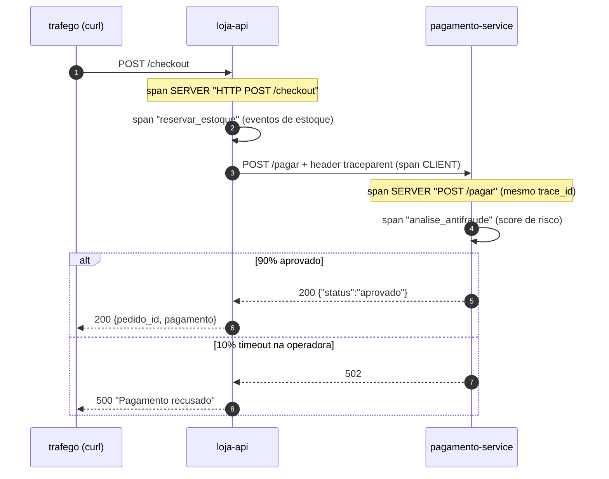
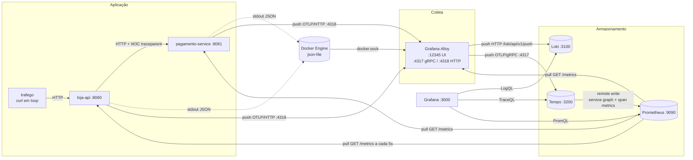

<!-- OBJETIVO (Início): Documentação técnica obrigatória do Projeto Final detalhando como o app funciona,
     arquitetura, responsabilidades dos componentes, fluxo de cada sinal (protocolos/portas),
     decisões de instrumentação e evidências. -->

# Documento de Arquitetura e Decisões de Instrumentação

**Grupo:** Tiago Camilo, Danilo Huberto, Eric Malone, Helierison Cardoso, Everton Genuino
**Repositório:** <https://github.com/Tiagocamilos/observabilidade>

> **Aplicação própria (não é o app da Aula 6).** A aplicação são **dois microsserviços escritos pelo grupo**
> (`loja-api` e `pagamento-service`). Um trace atravessa os dois serviços via propagação de contexto W3C.

## Sumário

1. [Como o app funciona](#1-como-o-app-funciona)
2. [Arquitetura: quem fala com quem](#2-arquitetura-quem-fala-com-quem)
3. [Responsabilidades de cada componente](#3-responsabilidades-de-cada-componente)
4. [Caminho de cada sinal](#4-caminho-de-cada-sinal-protocolo-direção-e-portas)
5. [Decisões de instrumentação](#5-decisões-de-instrumentação)
6. [Correlação entre os sinais](#6-correlação-entre-os-sinais)
7. [Evidências](#7-evidências-de-funcionamento)

---

## 1. Como o App Funciona

O sistema simula o **checkout de uma loja virtual**. Os dois serviços são escritos em **Python 3.12**, usando só a
biblioteca padrão (`http.server`) mais os SDKs de telemetria (`prometheus-client` e `opentelemetry-sdk`).

### `loja-api` (porta 8080): porta de entrada

| Rota | Método | O que faz | Resultado |
| :--- | :--- | :--- | :--- |
| `/` | GET | Health check simples | 200, ~5–30 ms |
| `/produtos` | GET | Lista o catálogo de produtos | 200, ~20–90 ms |
| `/checkout` | POST | Fecha um pedido: gera `pedido_id` e `valor`, **reserva estoque** e **chama o `pagamento-service`** | 200 se o pagamento for aprovado; 500 se for recusado ou se o serviço estiver indisponível |
| `/erro` | GET | Falha proposital da regra de negócio, para demonstrar erros nos 3 sinais | sempre 500 |
| `/metrics` | GET | Exposição das métricas para o Prometheus (fora dos traces e das métricas HTTP) | 200 |
| qualquer outra | GET/POST | Normalizada para `path="outro"` (controle de cardinalidade) | 200 |

### `pagamento-service` (porta 8081): serviço interno

| Rota | Método | O que faz | Resultado |
| :--- | :--- | :--- | :--- |
| `/pagar` | POST | Recebe `{pedido_id, valor}`, extrai o `traceparent` e faz uma **análise antifraude** (50–350 ms) | 200 aprovado; **502 em ~10% dos casos** (timeout simulado na operadora); 400 com corpo inválido |
| `/metrics` | GET | Exposição das métricas | 200 |

### Fluxo de um checkout



O serviço `trafego` (imagem `curlimages/curl`) roda `trafego/gerar-trafego.sh` em loop, com a seguinte distribuição
de chamadas: **45% `/checkout`, 30% `/produtos`, 20% `/` e 5% `/erro`**, uma a cada 0,4 s. Assim, logo após o
`docker compose up` já existem dados de sucesso e de erro nos três sinais.

---

## 2. Arquitetura: Quem Fala com Quem



Versão em texto (para leitores que não renderizam Mermaid):

```text
                       ┌─ stdout (JSON + trace_id) ──► Alloy ──► Loki ────────────┐
[loja-api :8080] ──────┼─ traces (OTLP/HTTP :4318) ──► Alloy ──► Tempo ───────────┼──► Grafana (:3000)
       │               └─ /metrics (Pull) ◄─────────── Prometheus (:9090) ◄───┐   ┘
       │ (W3C traceparent)                                                     │
       ▼                                                    remote write (service graph)
[pagamento-service :8081] ──► (emite os mesmos 3 sinais)        Tempo ────────┘
```

Todos os containers estão na mesma rede padrão do Compose e se encontram pelo **nome do serviço**
(`alloy`, `loki`, `tempo`, `prometheus`). As portas OTLP (4317/4318) do Alloy **não são publicadas no host**:
só os apps, dentro da rede do Compose, precisam delas.

---

## 3. Responsabilidades de Cada Componente

| Componente | Imagem | Papel | Sinal: gera / coleta / guarda / mostra |
| :--- | :--- | :--- | :--- |
| **`loja-api`** | build local (Python 3.12) | Porta de entrada HTTP. Cria o span raiz e spans manuais, injeta `traceparent` ao chamar o pagamento | **Gera** logs, métricas e traces |
| **`pagamento-service`** | build local (Python 3.12) | Serviço downstream. Extrai `traceparent` e continua o mesmo trace | **Gera** logs, métricas e traces |
| **`trafego`** | `curlimages/curl:8.22.0` | Gerador de carga contínua | (gera requisições) |
| **`alloy`** | `grafana/alloy:v1.20.1` | Agente: descobre containers com `logging=alloy` via `docker.sock`, recebe OTLP e agrupa em lote | **Coleta** logs e traces |
| **`loki`** | `grafana/loki:3.7.8` | Armazena logs em chunks no disco, indexando só labels de baixa cardinalidade (`service`, `container`) | **Guarda** logs |
| **`tempo`** | `grafana/tempo:2.7.2` | Armazena traces e, pelo *metrics-generator*, deriva métricas de service graph e de spans | **Guarda** traces (e gera métricas derivadas) |
| **`prometheus`** | `prom/prometheus:v3.15.0` | Faz *scrape* dos `/metrics` a cada 5 s, recebe *remote write* do Tempo e guarda **exemplars** | **Coleta e guarda** métricas |
| **`grafana`** | `grafana/grafana:13.2.3` | Sobe já provisionado (datasources + dashboard), com a correlação entre sinais configurada | **Mostra** tudo |

---

## 4. Caminho de Cada Sinal (Protocolo, Direção e Portas)

### 4.1 Logs: push via agente

1. A função `log()` de cada serviço escreve **uma linha JSON por evento** no `stdout`, com `trace_id` e
   `span_id` do span ativo.
2. O Docker Engine grava essas linhas com o driver `json-file`.
3. O **Alloy** (`discovery.docker` + `loki.source.docker`) lê os logs pelo `/var/run/docker.sock`, filtrando só
   os containers com o label `logging=alloy`. Ele aplica *relabel* criando os labels `service` (vindo do label
   `service` do compose) e `container`.
4. O Alloy envia os logs por **HTTP POST** para `http://loki:3100/loki/api/v1/push`.
5. O **Grafana** consulta o Loki em `:3100` com LogQL.

### 4.2 Métricas: pull (scrape)

1. Cada serviço mantém contadores, histogramas e gauges em memória (`prometheus-client`) e os expõe em
   `GET /metrics`.
2. O **Prometheus** faz *scrape* a cada **5 s** (`prometheus/prometheus.yml`) em `loja-api:8080`,
   `pagamento-service:8081`, `alloy:12345` e nele mesmo.
3. Quando o Prometheus pede **OpenMetrics** (header `Accept`), o serviço responde nesse formato, que inclui os
   **exemplars** (`trace_id` da última requisição de cada bucket).
4. Caminho adicional: o **Tempo** envia ao Prometheus, por **remote write** (`/api/v1/write`), as métricas
   `traces_service_graph_*` e `traces_spanmetrics_*`, que ele deriva dos spans.
5. O **Grafana** consulta o Prometheus em `:9090` com PromQL.

### 4.3 Traces: push via OTLP

1. O SDK OpenTelemetry (`TracerProvider` + `BatchSpanProcessor`) acumula os spans e os exporta em lote via
   **OTLP/HTTP** para `http://alloy:4318/v1/traces` (variável `OTEL_EXPORTER_OTLP_ENDPOINT`).
2. A `loja-api` injeta o header **W3C `traceparent`** na chamada ao pagamento, e o `pagamento-service` o extrai.
   O resultado é **um único trace com os spans dos dois serviços**.
3. O **Alloy** (`otelcol.receiver.otlp` → `otelcol.processor.batch` → `otelcol.exporter.otlp`) reencaminha os
   spans via **OTLP/gRPC** para `tempo:4317`.
4. O **Grafana** consulta o Tempo em `:3200` (TraceQL, busca e service map).

| Sinal | Modelo | Origem → Destino | Protocolo / Porta |
| :--- | :--- | :--- | :--- |
| Logs | Push (agente) | stdout → Alloy → Loki | docker.sock → HTTP `:3100` |
| Métricas | Pull | Prometheus → apps | HTTP GET `/metrics` `:8080` / `:8081` |
| Métricas derivadas | Push | Tempo → Prometheus | HTTP remote write `:9090` |
| Traces | Push | apps → Alloy → Tempo | OTLP/HTTP `:4318` → OTLP/gRPC `:4317` |
| Consulta | — | Grafana → backends | HTTP `:3100`, `:3200`, `:9090` |

---

## 5. Decisões de Instrumentação

### 5.1 O que logamos (e por quê)

* **Formato JSON estruturado**, uma linha por evento. Com isso o Loki extrai campos com `| json` sem regex
  frágil, e o Grafana encontra o `trace_id` para correlação.
* **Um log por requisição**, no fim do processamento, com `path`, `status`, `duration_ms`, `request_id` e,
  no pagamento, `pedido_id` e `valor`. Logar "no fim" garante que o status e a duração já são conhecidos.
* **Níveis com critério:**
  * `INFO`: requisição atendida ou pagamento aprovado.
  * `WARN`: requisição inválida do cliente (corpo inválido no `/pagar`).
  * `ERROR`: falhas 5xx, com o campo `erro` trazendo a causa (por exemplo, "Pagamento recusado pelo serviço
    downstream (HTTP 502)").
* **`trace_id` e `span_id` em todo log** emitido dentro de um span. É o elo com o Tempo.
* **Não logamos** o `/metrics` (o *scrape* a cada 5 s só geraria ruído) nem o access log padrão do
  `http.server` (`log_message` foi desativado, porque o nosso log já cobre isso).

### 5.2 O que medimos (e por quê)

Seguimos o **método RED** (Rate, Errors, Duration), que responde "o serviço está saudável para o usuário?",
e somamos uma métrica de saturação e uma de negócio:

| Métrica | Tipo | Labels | Pergunta que responde |
| :--- | :--- | :--- | :--- |
| `http_requests_total` | Counter | `service`, `path`, `status` | Quantas requisições por segundo (Rate)? Qual a fração de 5xx (Errors)? |
| `http_request_duration_seconds` | Histogram | `service`, `path` | Qual a latência p95/p99 (Duration)? |
| `pedidos_em_andamento` | Gauge | `service` | Quantas requisições simultâneas (saturação) existem na `loja-api`? |
| `pagamentos_total` | Counter | `service`, `resultado` | Quantos pagamentos são aprovados, recusados ou inválidos? (visão de negócio) |
| `traces_service_graph_*` | (gerada pelo Tempo) | `client`, `server` | Quem chama quem, com que taxa e com quantos erros? |

* **Histograma em vez de média ou Summary:** os buckets (`0.01s` a `2.5s`) foram escolhidos em torno das latências
  esperadas (dezenas a centenas de ms). Um histograma permite `histogram_quantile` agregando instâncias. Médias
  escondem caudas, e não se podem agregar percentis de um Summary.
* **Controle de cardinalidade:** os labels só têm valores finitos. Rotas desconhecidas viram `path="outro"`.
  Identificadores únicos (`request_id`, `pedido_id`, `trace_id`) **nunca** viram label: ficam no corpo do log,
  nos atributos dos spans e nos exemplars.

### 5.3 O que traceamos (e por quê)

| Span | Serviço | Kind | Atributos / Eventos | Por quê |
| :--- | :--- | :--- | :--- | :--- |
| `HTTP <método> <rota>` | loja-api | SERVER | `http.request.method`, `http.route`, `http.response.status_code`, `request.id`, `pedido.id`, `pedido.valor` | Visão da requisição inteira, do ponto de vista do usuário |
| `reservar_estoque` | loja-api | INTERNAL | `pedido.id`; eventos `verificando_disponibilidade_sku` e `estoque_reservado_com_sucesso` | Isola o tempo gasto no estoque |
| `chamar_pagamento_service` | loja-api | CLIENT | `pagamento.status`, `http.response.status_code`; evento `pagamento_aprovado`; exceção registrada em falha de rede | Mede a latência da dependência vista pelo chamador |
| `POST /pagar` | pagamento-service | SERVER | `pedido.id`, `pedido.valor`, `http.response.status_code` | Continua o trace no serviço downstream |
| `analise_antifraude` | pagamento-service | INTERNAL | `antifraude.score`; eventos `consultando_score_risco` e `score_calculado`; exceção em timeout | É a etapa mais lenta e a que falha: aqui mora o gargalo |

* **Instrumentação manual com o SDK OpenTelemetry.** Como o app usa `http.server` puro, que não tem
  auto-instrumentação, criamos os spans à mão. Isso deixa explícito onde cada span começa e termina.
* **`SpanKind` CLIENT/SERVER** nas bordas: além de ser semanticamente correto, é o que permite ao Tempo montar o
  **Service Graph** (`loja-api → pagamento-service`).
* **Erros:** `record_exception` + `set_status(ERROR)` deixam o span vermelho no Tempo, com stack/mensagem.
* **Atributos** seguem as convenções semânticas do OpenTelemetry (`http.request.method`, `http.route`,
  `http.response.status_code`). Os de negócio usam o prefixo `pedido.*`, `pagamento.*` e `antifraude.*`.

---

## 6. Correlação entre os Sinais

| De → Para | Como foi configurado | Onde usar |
| :--- | :--- | :--- |
| **Log → Trace** | `derivedFields` no datasource Loki: a regex `"trace_id":\s*"([a-f0-9]{32})"` cria um link para o Tempo | Explore → Loki → expanda uma linha → botão **Tempo** |
| **Trace → Logs** | `tracesToLogsV2` no datasource Tempo: query `{service="<service.name>"} \| json \| trace_id="<traceId>"` | No trace, ícone **Logs for this span** |
| **Métrica → Trace** | **Exemplars**: os apps anexam o `trace_id` a cada observação, e o Prometheus guarda (`--enable-feature=exemplar-storage`) e o datasource aponta `trace_id` → Tempo | Painel "Duration — p95 por Serviço e Rota": clique num losango |
| **Trace → Métricas** | `tracesToMetrics` no datasource Tempo (taxa e p95 do serviço do span) | No trace, menu do span → **Related metrics** |
| **Mapa de serviços** | `metrics_generator` do Tempo (service-graphs + span-metrics) → remote write → Prometheus; `serviceMap` no datasource Tempo | Explore → Tempo → aba **Service Graph**, ou o painel *Service Graph* no dashboard |

O `OTEL_SERVICE_NAME` de cada serviço tem **o mesmo valor do label `service`** do compose. É isso que faz a
query trace → logs encontrar o stream certo no Loki.

---

## 7. Evidências de Funcionamento

Os prints estão na pasta [`evidencias/`](../evidencias/), e o passo a passo para gerá-los está em
[`evidencias/ROTEIRO.md`](../evidencias/ROTEIRO.md).

| # | Arquivo | O que comprova |
| :--- | :--- | :--- |
| 1 | [`01-docker-compose-ps.png`](../evidencias/01-docker-compose-ps.png) | Os 8 containers no ar (`Up`) |
| 2 | [`02-grafana-dashboard-red.png`](../evidencias/02-grafana-dashboard-red.png) | **Métricas** (Prometheus) no dashboard RED + logs |
| 3 | [`03-loki-logs-traceid.png`](../evidencias/03-loki-logs-traceid.png) | **Logs** (Loki) em JSON com `trace_id` e link para o Tempo |
| 4 | [`04-tempo-trace-distribuido.png`](../evidencias/04-tempo-trace-distribuido.png) | **Traces** (Tempo): um trace atravessando `loja-api` → `pagamento-service` |
| 5 | [`05-trace-para-logs.png`](../evidencias/05-trace-para-logs.png) | Correlação trace → logs |
| 6 | [`06-prometheus-targets.png`](../evidencias/06-prometheus-targets.png) | Targets do Prometheus todos `UP` |
| 7 | [`07-service-graph.png`](../evidencias/07-service-graph.png) | Service Graph `loja-api → pagamento-service` |
| 8 | [`08-trace-com-erro.png`](../evidencias/08-trace-com-erro.png) | Trace com erro (502 do pagamento) com span vermelho |

Há também uma prova em texto, coletada por script: [`evidencias/saida-verificacao.txt`](../evidencias/saida-verificacao.txt)
(gerada por `evidencias/coletar.sh`).

<!-- RESUMO FINAL (Fim): Documentação completa exigida pelos critérios de avaliação do Projeto Final,
     cobrindo funcionamento do app, arquitetura, responsabilidades, caminho dos sinais, decisões
     de instrumentação, correlação e evidências. -->
