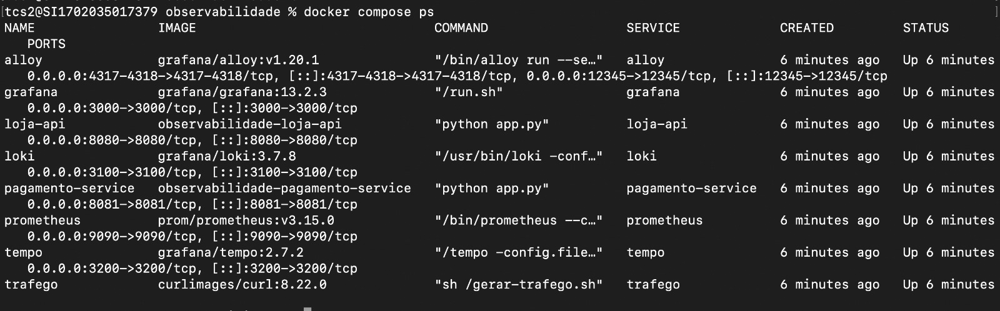
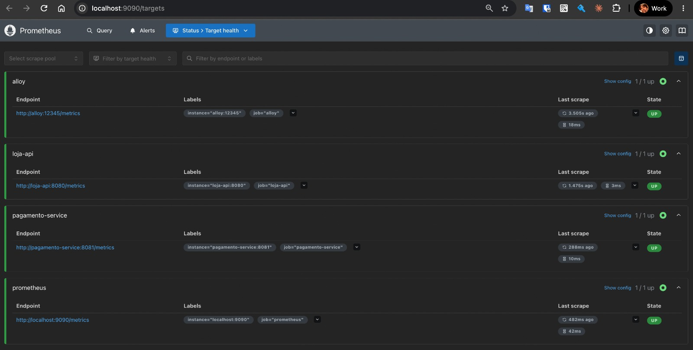
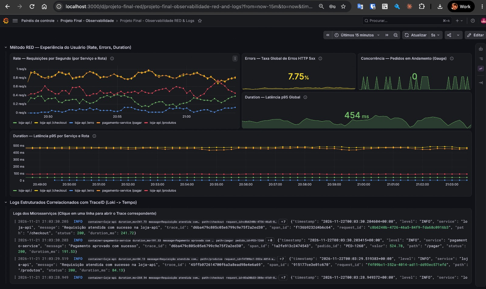
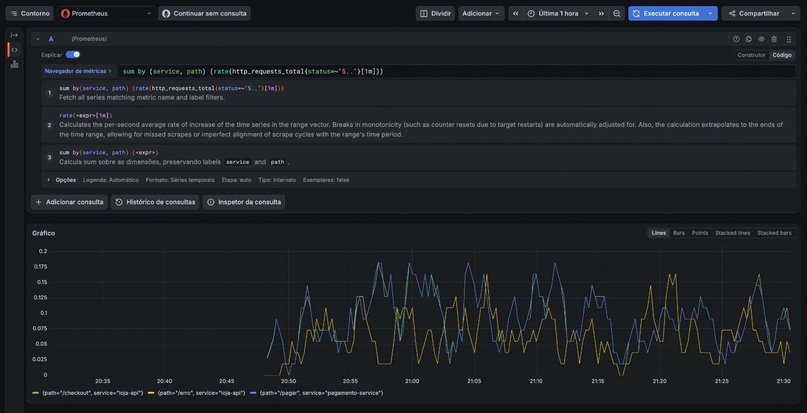
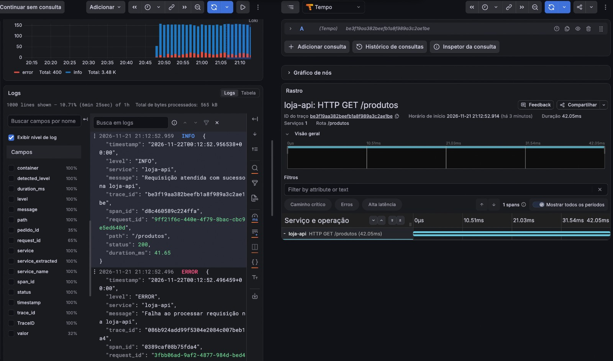
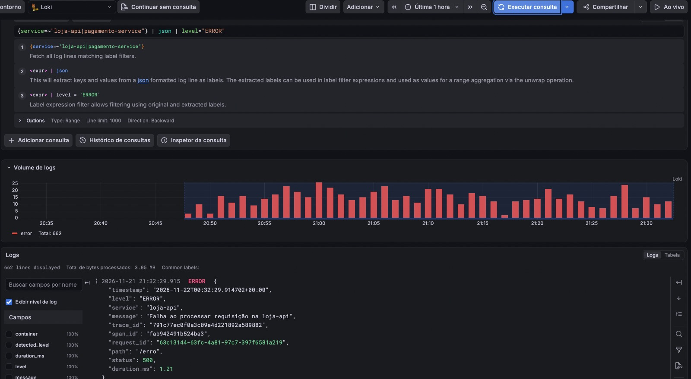
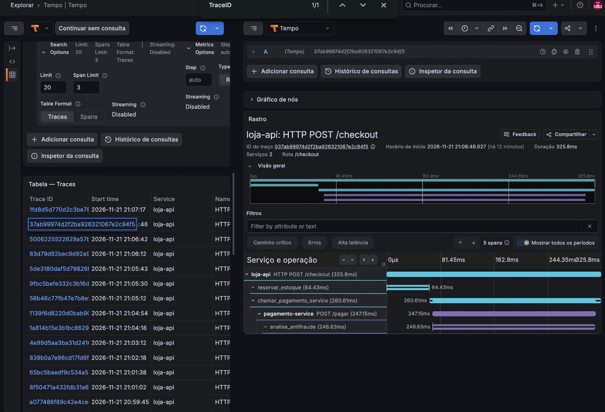
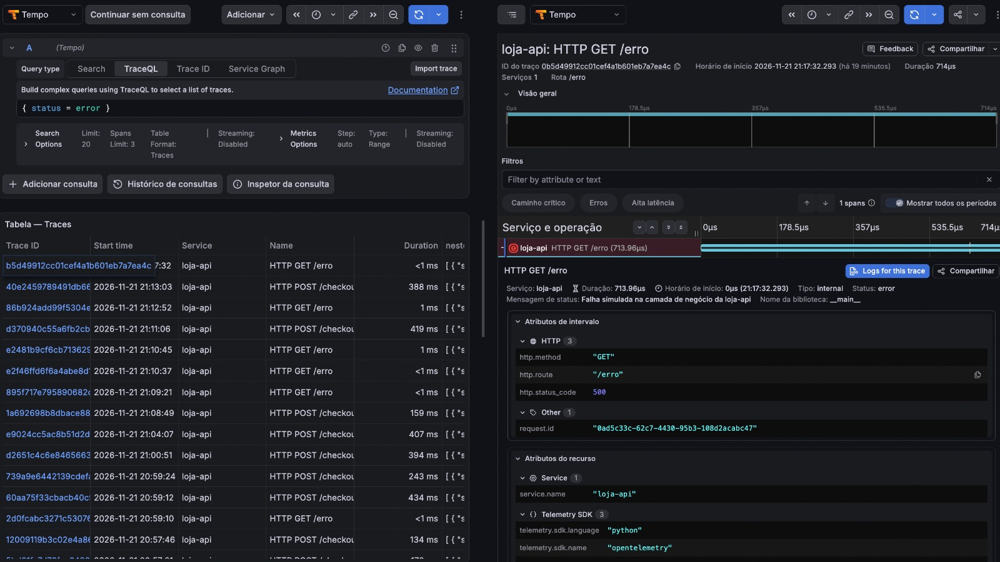
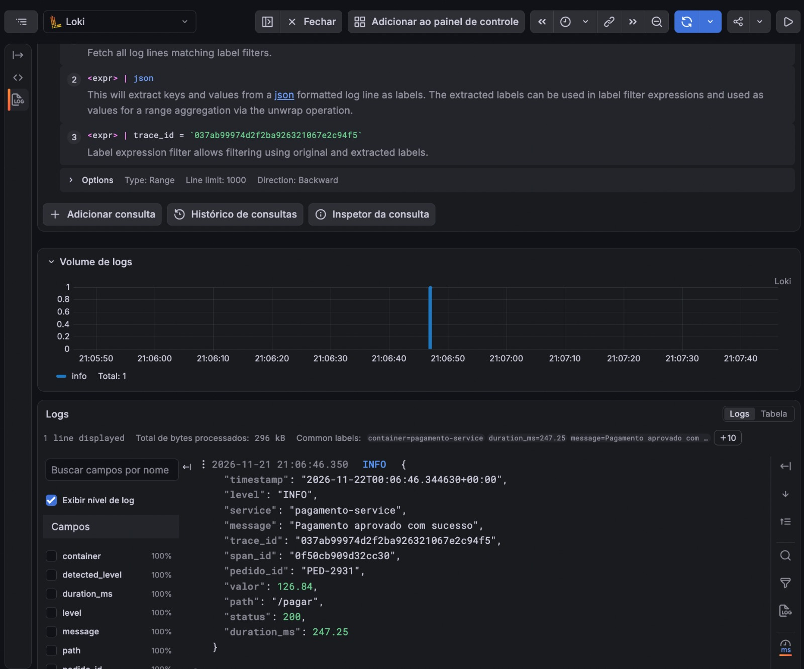
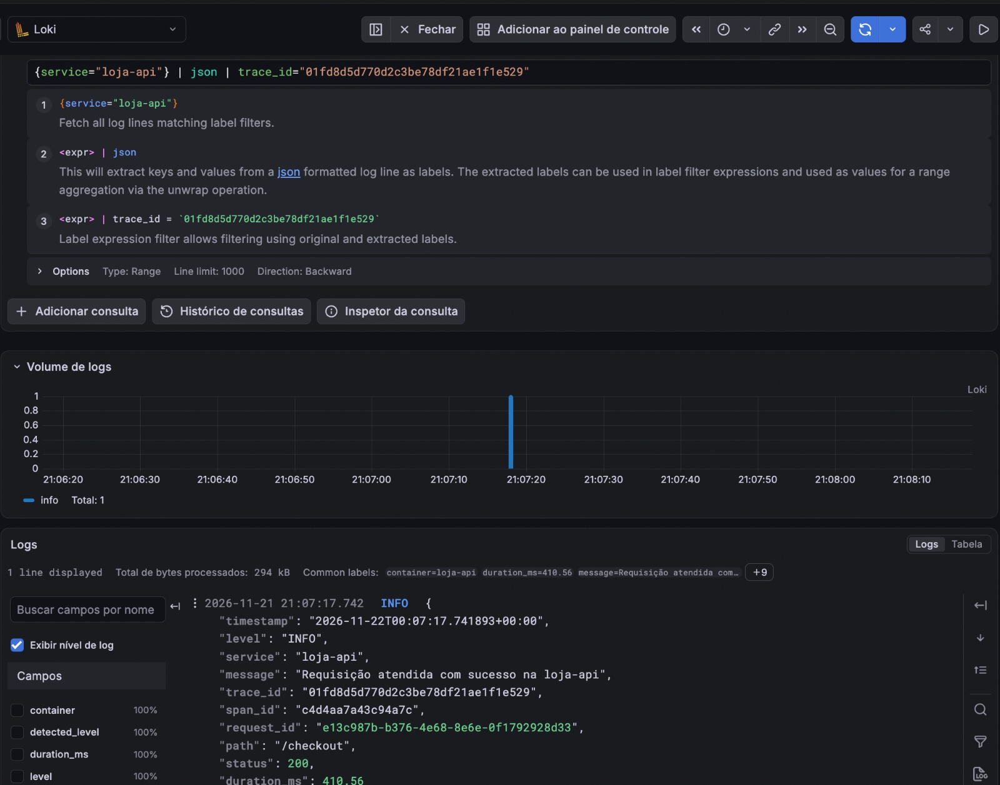

# Evidências de execução

Prints tirados com a stack no ar (`docker compose up -d --build`). 
Conteúdo em texto: [`saida-verificacao.txt`](saida-verificacao.txt) (gerado pela execução do `coletar.sh`).

## 1. Stack no ar

## 2. Métricas (Prometheus → Grafana)
Targets do Prometheus:

Dashboard RED provisionado:

Respostas 5xx por serviço e rota:

## 3. Logs (Alloy → Loki → Grafana)
Logs JSON com `trace_id` e link para o Tempo:

Logs de erro (`level="ERROR"`):

## 4. Traces (OpenTelemetry → Alloy → Tempo → Grafana)
Trace distribuído `POST /checkout` (loja-api → pagamento-service):

Trace de checkout com erro (atravessa os dois serviços):

## 5. Correlação trace → logs
Logs do `pagamento-service` filtrados pelo `trace_id` do trace:

Logs da `loja-api` filtrados pelo mesmo mecanismo:

